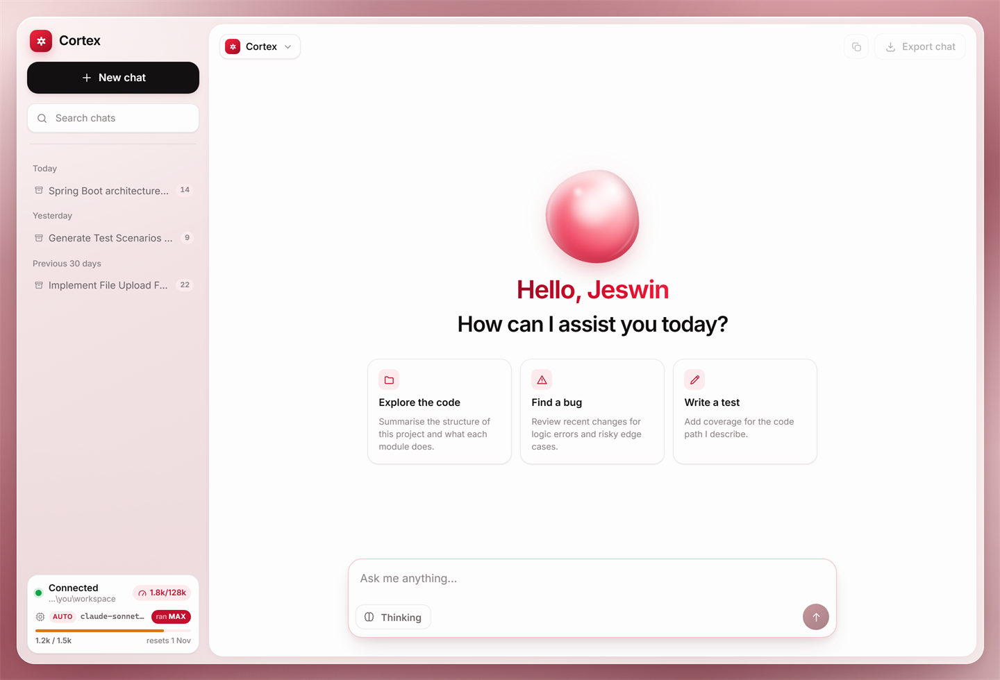
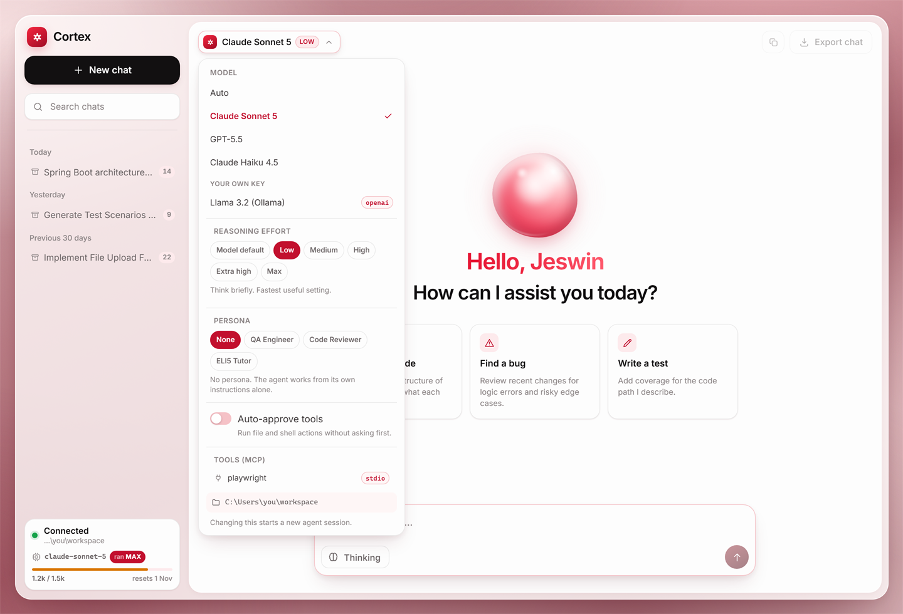
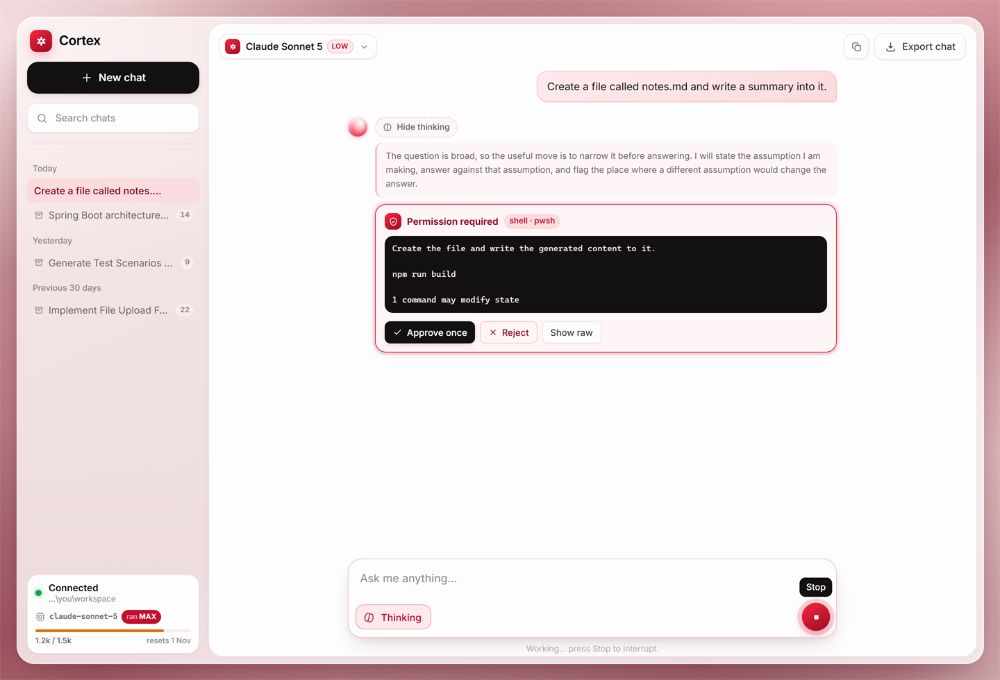
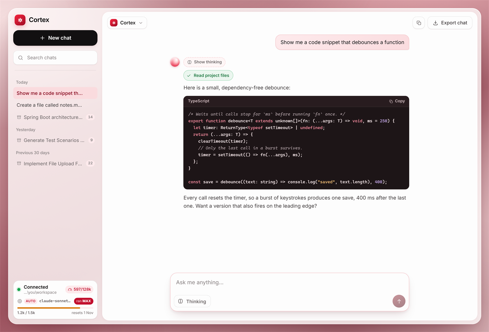
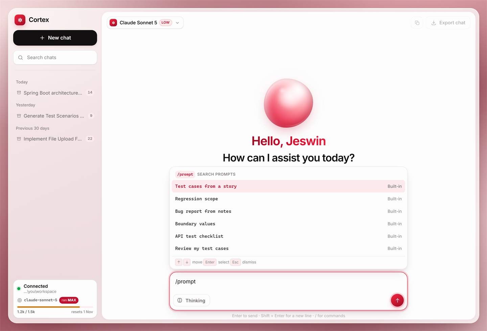
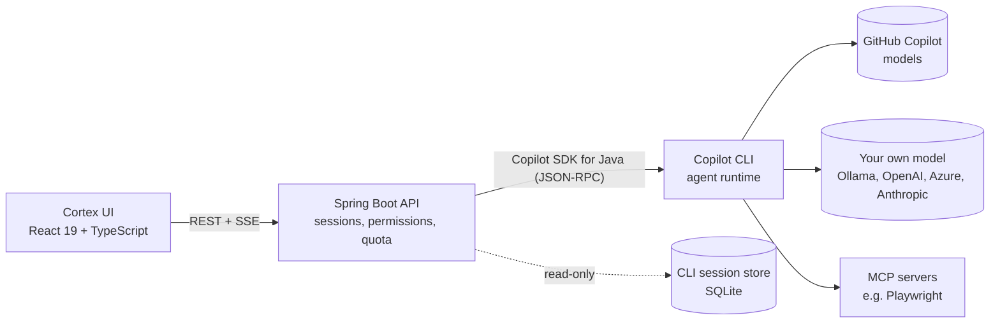

# Cortex

A self-hosted, full-stack chat client for the GitHub Copilot agent. A **Spring Boot** service drives
the Copilot runtime through the official [Copilot SDK for Java](https://github.com/github/copilot-sdk-java),
and a **React + TypeScript** UI streams its answers, tool calls and permission requests in real
time. It can also run on your own model (Ollama, OpenAI, Azure OpenAI, Anthropic) and plug in MCP
tool servers.



**Stack:** Java 17 · Spring Boot 3.3 · Copilot SDK for Java · SQLite (read-only) · React 19 ·
TypeScript 6 · Vite 8 · Vitest · oxlint · Playwright · GitHub Actions

## Features

| Feature | What it does |
|---|---|
| **Streaming chat** | Server-Sent Events from the agent runtime: thinking, tool progress and the answer, with replay when the browser reconnects. |
| **Human in the loop** | Actions that need permission (shell commands, file writes, MCP tool calls) wait for **Approve once** or **Reject** unless you turn on auto-approve, which asks for confirmation first. |
| **Real quota gauge** | Reads the premium-request allowance from your Copilot account (cached for 60 s) and shows usage and the reset date. Falls back to a local estimate when the account can't be read. |
| **Bring your own model** | OpenAI-compatible endpoints (including Ollama), Azure OpenAI and Anthropic, listed alongside the Copilot models. The key comes from an environment variable and never reaches the browser. |
| **MCP tools** | Add Model Context Protocol servers (for example Playwright for browser automation) in `application.yml`. Their tools go through the same permission prompt. |
| **Personas** | QA Engineer, Code Reviewer and ELI5 Tutor ship by default. Each adds its instructions to the system prompt, and you can define your own in config. |
| **QA prompt library** | `/prompt` opens six built-in QA prompts (test cases from a story, regression scope, boundary values, bug report from notes, and more). `/save` turns your last message into a reusable prompt. |
| **Code blocks** | Syntax highlighting from a small built-in highlighter (no extra dependency) and one-click copy. |
| **Past chats** | Browses earlier sessions from the Copilot CLI's own session store, read-only. |
| **One command** | `start.ps1` / `start.sh` builds the UI into the Spring Boot jar and serves everything on one port. |

| Model menu: own models, effort, personas, MCP | Tool approval |
|---|---|
|  |  |
| **Code blocks** | **QA prompt library** |
|  |  |

## Architecture



- **The backend owns the agent.** One SDK client supervises the Copilot CLI process, and every chat
  is an SDK session. The browser never talks to Copilot directly.
- **Events flow one way.** Runtime events are normalised and fanned out to every connected browser
  over SSE, with a bounded replay buffer for reconnects.
- **A blocked tool call is a parked future.** The runtime's permission request waits on the server
  until a human answers in the UI, or it is denied after a timeout.

## Quick start

**You need:** JDK 17+, Maven 3.9+, Node.js 22 LTS, and the GitHub Copilot CLI
(`npm install -g @github/copilot`). Run `copilot` once to sign in, unless you only use your own
model (see below).

```powershell
.\start.ps1          # Windows (if scripts are blocked: powershell -ExecutionPolicy Bypass -File .\start.ps1)
```

```bash
bash start.sh        # macOS / Linux
```

Open <http://localhost:8080>. The first run installs and builds both projects. Options:
`-SkipBuild` / `--skip-build` reuses the jar, and `-Port 9090` / `--port 9090` changes the port. Any
other argument goes to Spring Boot, so every `copilot.*` setting can be overridden from the command
line.

### Run it on your own model

Own-key models talk to your endpoint directly and use no Copilot premium requests. For a local,
free setup with [Ollama](https://ollama.com):

```powershell
ollama pull llama3.2
.\start.ps1 --copilot.provider.type=openai --copilot.provider.base-url=http://localhost:11434/v1 "--copilot.provider.models[0]=llama3.2"
```

For a hosted provider, set `CORTEX_PROVIDER_API_KEY` first. The key is read from the environment
and is never written to a file or returned by the API.

### Add an MCP server

In `copilot-dashboard/backend/src/main/resources/application.yml`:

```yaml
copilot:
  mcp-servers:
    playwright:
      command: npx
      args: ["-y", "@playwright/mcp@latest"]
```

### Dev mode (hot reload)

In two terminals:

```bash
cd copilot-dashboard/backend && mvn spring-boot:run    # API on :8080
cd cortex-chat && npm install && npm run dev           # UI on :5174, proxies /api to :8080
```

Open <http://localhost:5174/?mock> to run the UI against its built-in simulator, with no backend
and no model calls.

## Tests

| What | Command | Folder |
|---|---|---|
| 28 backend unit tests (JUnit 5 + Mockito; no CLI, network or sign-in) | `mvn verify` | `copilot-dashboard/backend` |
| 94 UI unit tests (Vitest) | `npm test` | `cortex-chat` |
| Lint, type-check and production build | `npm run lint` and `npm run build` | `cortex-chat` |
| 23-step browser harness: 31 screenshots, fails on any console error, layout overflow or failed assertion | `npm run dev`, then `node shot.mjs` | `cortex-chat` |

[CI](.github/workflows/ci.yml) runs the unit tests, lint and build on every push and pull request.
The harness drives your installed Chrome (`CHROME_PATH` overrides the location) and defaults to
the simulator; `node shot.mjs --live` runs the same steps against the real backend.

## Project layout

```
.
├── copilot-dashboard/
│   ├── backend/      Spring Boot API: sessions, SSE, permissions, quota, own models, MCP, personas
│   ├── frontend/     the first UI, a "mission control" dashboard (port 5173 in dev)
│   └── README.md     API reference, configuration and troubleshooting
├── cortex-chat/      the Cortex chat UI (port 5174 in dev)
│   └── README.md     design notes and the techniques behind them
├── docs/screenshots/
├── start.ps1, start.sh
└── .github/workflows/ci.yml
```

## Security notes

- **Loopback only by default.** The API has no login and can run tools on your machine, so it binds
  to `127.0.0.1`. Setting `CORTEX_BIND_ADDRESS=0.0.0.0` exposes it to the network; only do that if
  you accept the risk.
- **Keys stay on the server.** Provider keys come from an environment variable; `/api/config` only
  reports whether one is set.
- **Tools need consent.** Shell, file-write and MCP actions wait for approval unless you turn on
  auto-approve.
